

  <a href="https://github.com/SoFTeR1/otium-release/releases/latest">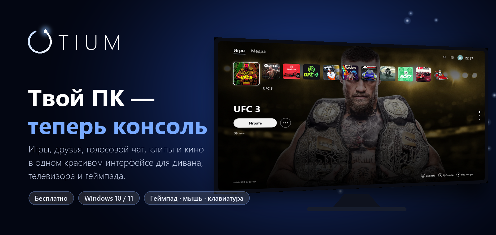</a>

  
  
  
  

<h3 align="center">Игры, друзья, голосовой чат, клипы и кино — в одном интерфейсе для дивана, телевизора и геймпада.</h3>

  Запустил компьютер — и сразу попал в консольное меню. Все игры в одном ряду, друзья онлайн, 
  музыка и звук под кнопкой Xbox, клип последних 30 секунд одним нажатием. Без мыши, без рабочего стола, без возни.

  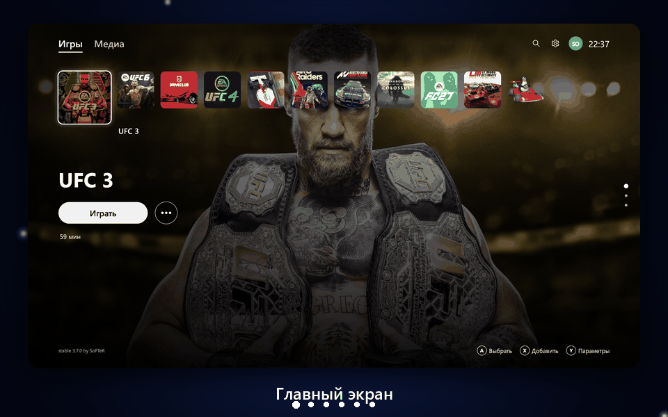

  <b><a href="#-установка">Установка</a></b> ·
  <b><a href="#-возможности">Возможности</a></b> ·
  <b><a href="#-экраны-otium">Экраны</a></b> ·
  <b><a href="#-управление">Управление</a></b> ·
  <b><a href="#-что-нового">Что нового</a></b> ·
  <b><a href="#-частые-вопросы">Вопросы</a></b>

> **Otium** (лат.) — досуг, время для себя. Именно для этого OTIUM и сделан: чтобы вечером взять геймпад, сесть на диван и просто играть.

<table>
<tr>
<td width="33%" valign="top">

### 🎮 Консоль из любого ПК
Интерфейс в духе PlayStation 5: им удобно пользоваться с геймпада с первой минуты, а на телевизоре он выглядит как настоящая приставка. Мышь и клавиатура тоже работают.

</td>
<td width="33%" valign="top">

### ⚡ Лёгкий и быстрый
Написан на Rust: один файл примерно на 30 МБ, запуск за секунду и около 80 МБ памяти в покое. Пока вы играете, OTIUM почти не нагружает компьютер и не отнимает видеокарту у игры.

</td>
<td width="33%" valign="top">

### 👥 Друзья без регистрации
Аккаунт создаётся за секунду, без почты и паролей. Друзья, чат, звонки и группы работают через открытую сеть Nostr, а сообщения шифруются.

</td>
</tr>
<tr>
<td width="33%" valign="top">

### 🎙 Голос, как в Discord
Звонки ПК-ПК с шумо- и эхоподавлением и активацией по голосу. Группы до 5 человек со своим чатом и голосовой комнатой, виджет звонка поверх игры.

</td>
<td width="33%" valign="top">

### 🎬 Клипы, как на PS5
Последние 30 секунд игры всегда в памяти. Одно нажатие — и момент сохранён в 1080p и 60 кадров. Отправьте его другу прямо в чат.

</td>
<td width="33%" valign="top">

### 📺 Диван и телевизор
Кнопка «На ТВ» переносит картинку и звук на телевизор, «На монитор» возвращает всё как было. Кинопоиск, YouTube и Twitch — на весь экран с геймпадом.

</td>
</tr>
</table>

 

| Без OTIUM | С OTIUM |
|---|---|
| Рабочий стол, ярлыки и десяток лаунчеров | Все игры в одном ряду с обложками и фонами |
| Встать и дотянуться до мыши, чтобы запустить игру | Всё делается с геймпада, не вставая с дивана |
| Discord, музыка и громкость — в разных окнах | Кнопка Xbox открывает всё сразу, прямо поверх игры |
| Сторонняя программа для записи клипов | Клип последних 30 секунд одним нажатием |
| Переключать вывод на телевизор в настройках Windows | Одна кнопка «На ТВ» |

## ✨ Возможности

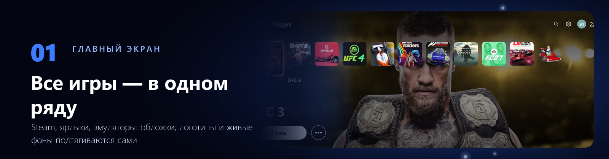

**Главный экран — все ваши игры в одном месте.**

- Игры Steam импортируются целиком, сразу с обложками, фонами и логотипами
- Добавляйте что угодно: `.exe`, ярлыки `.lnk` / `.url`, ссылки `steam://…`, эмуляторы
- **Живые фоны**: задержитесь на игре из Steam, и через пару секунд появится её трейлер, как на PS5
- Свой фон для каждой игры или общие фоны со сменой по таймеру
- Время в игре, новости и трофеи Steam на странице игры, уведомление о новом трофее после игры
- Игры открываются поверх OTIUM, рабочий стол не мелькает. «Закрыть игру» — прямо из лаунчера

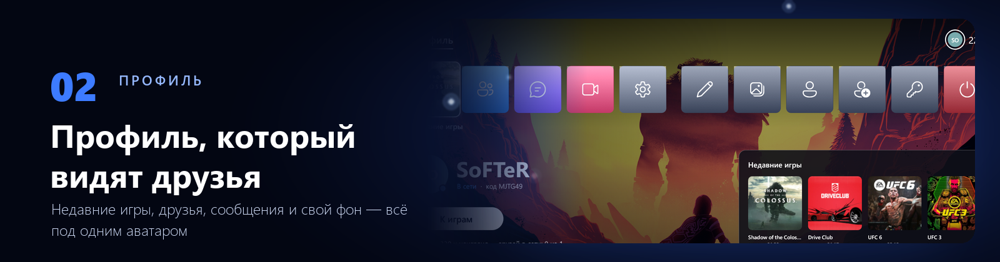

**Профиль — ваша страница, которую видят друзья.**

- Аватар в верхней панели открывает профиль: недавние игры, друзья, сообщения, клипы и настройки профиля
- **Свой фон профиля**: арт любой вашей игры или своя картинка с компьютера
- Профиль любого игрока открывается в том же виде: его игры, время в них, последний трофей и статус «в сети / в игре»
- «Как видят мой профиль» — посмотрите на свою страницу глазами друзей
- Код друга и ключ входа копируются одной кнопкой

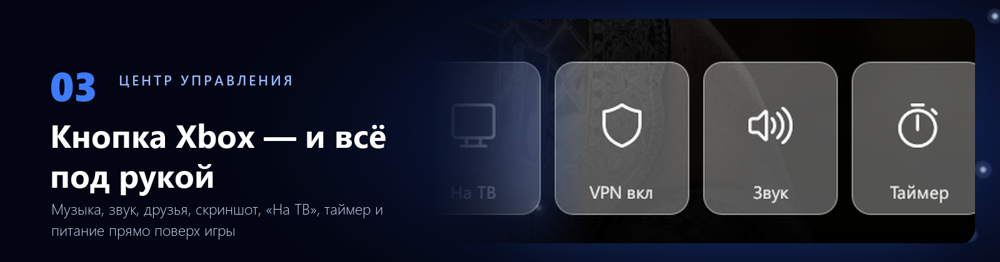

**Центр управления — кнопка Xbox из любого места, даже из игры.**

- Музыка (Яндекс Музыка, Spotify и любой плеер Windows), микшер громкости приложений
- Друзья и звонок, скриншот и клип
- «На ТВ» / «На монитор», VPN одной плиткой (v2RayTun)
- Таймер выключения: через 30 минут … 2 часа или к нужному времени. Сон, перезагрузка, выключение
- Повторное нажатие возвращает в игру. Остальные кнопки геймпада в игре OTIUM не трогает

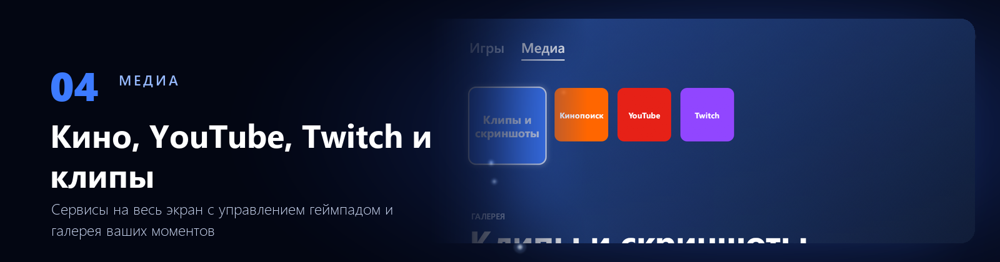

**Медиа — кино, видео и ваши моменты.**

- **Кинопоиск, YouTube и Twitch** на весь экран. YouTube открывается в версии для телевизора и листается крестовиной
- Стик двигает курсор, A — клик, правый стик листает. Каждый сервис живёт в своём окне со своим входом и не трогает ваш браузер
- Перед Кинопоиском OTIUM предложит выключить VPN и сам включит его обратно
- **Клипы и скриншоты**: галерея с просмотром, удалением и отправкой другу. В чате клип выглядит как карточка с превью и статусом отправки, а открывается одним кликом

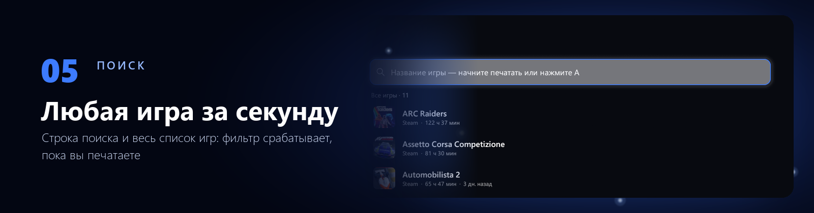

**Поиск — любая игра за секунду.** Строка поиска и весь список игр: фильтр срабатывает, пока вы печатаете, с клавиатуры или экранной клавиатурой.

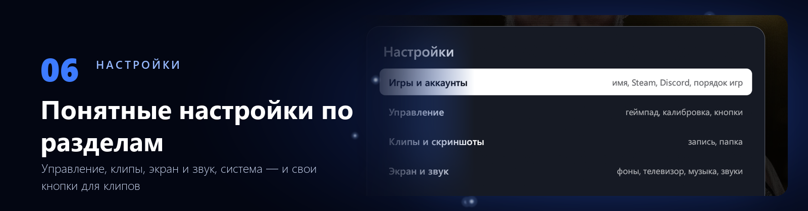

**Настройки — понятные разделы вместо длинного списка.**

- **Игры и аккаунты** · **Управление** · **Клипы и скриншоты** · **Экран и звук** · **Система**
- Свои кнопки для клипа и скриншота (View + RB, View + R3, L3 + R3 и другие)
- Проверка геймпада с живой схемой и калибровка стиков: меню больше не «уплывает» само
- Подсказки кнопок Xbox или PlayStation определяются автоматически

### И ещё

- 💬 **Чат в стиле Discord**: сообщения доходят, даже если друг был не в сети. Друзья OTIUM и Steam в одной панели
- 🟣 **Статус в Discord**: «Играет в …» с обложкой игры и временем
- 🔔 **Оверлей поверх игр**: виджет звонка, входящие звонки и уведомления
- 🎵 **Атмосфера**: заставка при запуске, фоновая музыка в лаунчере, звуки интерфейса — как у приставки
- ⌨️ **Экранная клавиатура** с раскладками RU, EN, символами и эмодзи — печатать удобно и с геймпада
- 🔄 **Обновления внутри лаунчера**: когда выходит новая версия, сверху появляется плашка «Обновить»
- 🗂 **Трей и автозапуск**: ПК может сразу загружаться в OTIUM, а свёрнутый лаунчер продолжает принимать звонки

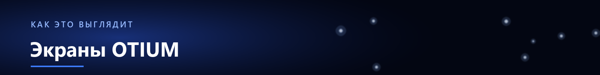

## 🖼 Экраны OTIUM

<table>
<tr>
<td width="50%">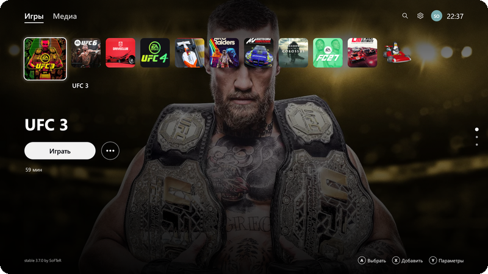
<b>Главный экран</b>
</td>
<td width="50%">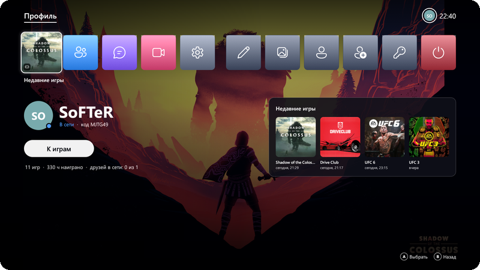
<b>Профиль</b>
</td>
</tr>
<tr>
<td width="50%">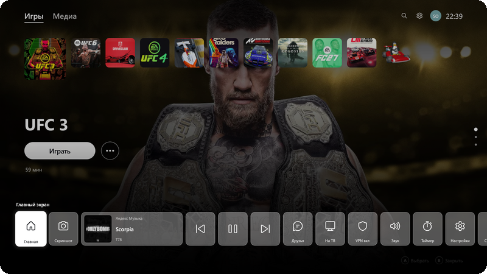
<b>Центр управления</b>
</td>
<td width="50%">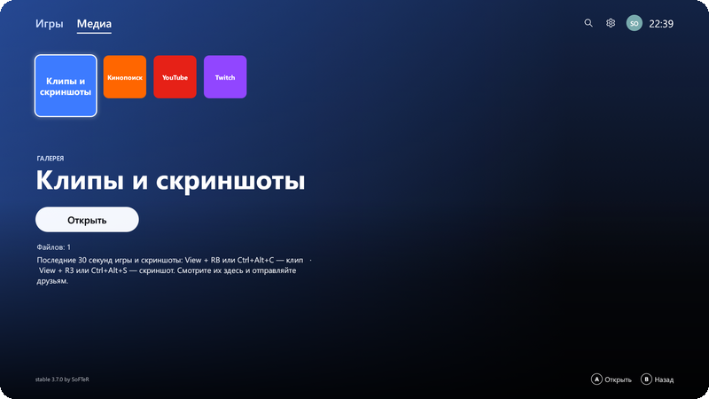
<b>Медиа</b>
</td>
</tr>
<tr>
<td width="50%">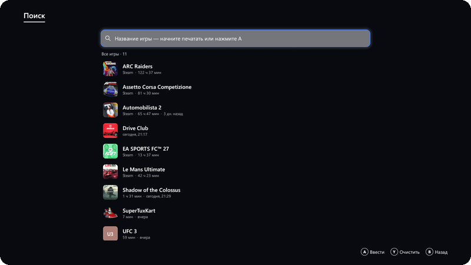
<b>Поиск игр</b>
</td>
<td width="50%">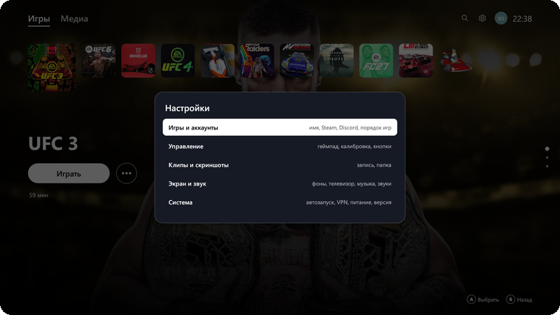
<b>Настройки</b>
</td>
</tr>
</table>

## 📥 Установка

1. Откройте [**последний релиз**](https://github.com/SoFTeR1/otium-release/releases/latest).
2. Скачайте **`OTIUM-Setup-x.y.z.exe`** и запустите — OTIUM установится за пару секунд и сразу откроется.
   Подойдёт и **`OTIUM-Installer.exe`**: он сам загрузит последнюю версию и даст выбрать папку.
3. Если Windows SmartScreen покажет «Windows защитила ваш компьютер» — нажмите **Подробнее → Выполнить в любом случае**. Это обычное предупреждение для программ без платной цифровой подписи.
4. Готово: OTIUM появится на рабочем столе и в меню «Пуск».

**Обновления приходят сами**: OTIUM проверяет их при запуске и раз в несколько часов. Нажмите плашку «Обновить» — и лаунчер обновится и перезапустится. Библиотека, обложки, друзья и настройки сохраняются.

**Удаление** — через «Параметры Windows → Приложения». Ваши данные (`%APPDATA%\OTIUM`) остаются, их можно удалить вручную.

### 🚀 Первый запуск

1. **Добавьте игры.** Кнопка X / □ (или N на клавиатуре) — выберите `.exe`, ярлык или ссылку `steam://…`. Или импортируйте все игры Steam разом: **Настройки → Игры и аккаунты**.
2. **Подключите Steam** (по желанию). Для трофеев и друзей Steam нужен бесплатный [Steam Web API-ключ](https://steamcommunity.com/dev/apikey): **Настройки → Игры и аккаунты → Аккаунт Steam**.
3. **Создайте аккаунт OTIUM**: нажмите на аватар и введите ник. Друзья найдут вас по нику или по коду друга.
4. **Откалибруйте геймпад** (по желанию): **Настройки → Управление**.
5. **Включите автозапуск**, если хотите, чтобы ПК сразу загружался в OTIUM: **Настройки → Система**.

## 🎮 Управление

| Действие | Геймпад (Xbox / DualSense) | Клавиатура |
|---|---|---|
| Навигация | D-pad / левый стик | Стрелки |
| Выбрать / Играть | A / ✕ | Enter |
| Назад | B / ○ | Esc |
| Параметры игры, позвонить в чате | Y / △ | Q |
| Добавить игру / найти друзей | X / □ | N, Insert |
| Настройки | ≡ Start / Options | — |
| Центр управления | Кнопка Xbox / PS или View + Start | Home; из любого места — Ctrl+Alt+Home |
| Сохранить клип (последние 30 секунд) | View + RB *(меняется в настройках)* | Ctrl+Alt+C |
| Скриншот | View + R3 *(меняется в настройках)* | Ctrl+Alt+S |
| Поиск игр, настройки, профиль | Вверх от ряда игр | Стрелка вверх |
| Полный экран | — | F11 |

**Мышь**: наведение выбирает пункт, клик нажимает; игра запускается двойным кликом; колесо листает, правая кнопка — назад.

**Экранная клавиатура**: A — клавиша, X или RB — стереть, Y — пробел, LB — заглавные, Start — готово.

## 🆕 Что нового

### 3.7 — профиль игрока

- Аватар открывает профиль в стиле главного экрана: недавние игры, друзья, сообщения, клипы, настройки профиля
- Свой фон профиля, который видят другие игроки, — арт игры или своя картинка
- Профиль любого игрока в том же виде: друга, игрока из поиска и свой «глазами других»
- Настройки разбиты на разделы, кнопки клипа и скриншота можно переназначить
- Новый экран поиска игр, клипы в чате с превью и прогрессом отправки
- Кнопки «Скопировать» для кода друга и ключа входа, картинки в полном разрешении

<b>3.6 — клипы и скриншоты</b>

- Клипы, как Create на PS5: последние 30 секунд картинки (1080p, 60 кадров) и звука хранятся в памяти и сохраняются в MP4 одним нажатием. Меню OTIUM в клип не попадает
- Скриншоты одним нажатием, клип и скриншот есть и в центре управления
- Галерея «Клипы и скриншоты» во вкладке «Медиа»: просмотр со звуком, удаление, показ в папке
- Отправка другу в чат: файл идёт напрямую между ПК. Если друг не в сети, он получит файл позже — предложение действует 7 дней

<b>3.5 — кнопка «На ТВ»</b>

- Картинка и звук переходят на телевизор одним нажатием, «На монитор» возвращает всё как было. Без подтверждения всё откатится само через 15 секунд

<b>3.3 — живые фоны</b>

- Задержитесь на игре из Steam, и через пару секунд появится её трейлер, как на PS5
- Общие фоны: свои картинки и видео со сменой по таймеру

<b>3.2 — YouTube для телевизора и VPN</b>

- YouTube в версии для телевизора: листается крестовиной, A — выбрать, B — назад
- Геймпад в Кинопоиске и Twitch: стик двигает курсор, A — клик, правый стик листает
- VPN одной кнопкой: плитка в центре управления включает и выключает v2RayTun

<b>3.1 — вкладка «Медиа»</b>

- Кинопоиск, YouTube и Twitch открываются прямо из OTIUM на весь экран, каждый в своём окне со своим входом

<b>3.0 — OTIUM переписан с нуля</b>

- Новый движок на Rust: один файл примерно на 30 МБ вместо 80, быстрый запуск, около 80 МБ памяти в покое
- Центр управления как на PS5: игра, звонок, музыка, друзья, звук, таймер, питание
- Поиск игр и настройки в верхней строке, управление мышью вместе с геймпадом
- Фоновая музыка, друзья Steam в панели друзей, обновления внутри лаунчера

## ❓ Частые вопросы

<b>Это бесплатно?</b>

Да, полностью. Без подписок, рекламы и регистрации.

<b>Какие игры поддерживаются?</b>

Любые, которые запускаются на Windows: игры Steam (импортируются с артом), игры из других магазинов через ярлык или `.exe`, эмуляторы и даже обычные приложения.

<b>Нужен ли геймпад?</b>

Нет. OTIUM полностью управляется мышью и клавиатурой. С геймпадом Xbox, DualSense, DualShock или любым XInput-совместимым удобнее всего.

<b>Кнопка Xbox не открывает OTIUM.</b>

Скорее всего, её перехватывает Steam или Xbox Game Bar. Используйте View + Start или отключите Game Bar в «Параметры → Игры».

<b>Меню само прокручивается.</b>

Стик дрейфует. Пройдите калибровку: **Настройки → Управление → Геймпад: проверка и калибровка**.

<b>Не видно трофеев и друзей Steam.</b>

Добавьте Steam Web API-ключ в **Настройки → Игры и аккаунты → Аккаунт Steam** и проверьте, что профиль Steam открыт.

<b>Как перенести OTIUM на другой ПК?</b>

Библиотека хранится в `%APPDATA%\OTIUM\library.json` — скопируйте этот файл. Аккаунт друзей переносится ключом входа: **Профиль → Настройки профиля → Ключ входа на другом ПК**.

<b>Безопасно ли общаться в чате?</b>

Сообщения шифруются и доставляются через открытую сеть Nostr — никакого центрального сервера с вашей перепиской. Звонки и клипы идут напрямую между компьютерами.

## 💻 Требования

- Windows 10 или 11 (64-бит)
- Геймпад — по желанию: Xbox, DualSense / DualShock или любой XInput-совместимый

  

  Интерфейс OTIUM вдохновлён оболочкой PlayStation 5. OTIUM — независимый проект и не связан с Sony Interactive Entertainment, Microsoft или Valve. 
  © SoFTeR1. Все права защищены.

